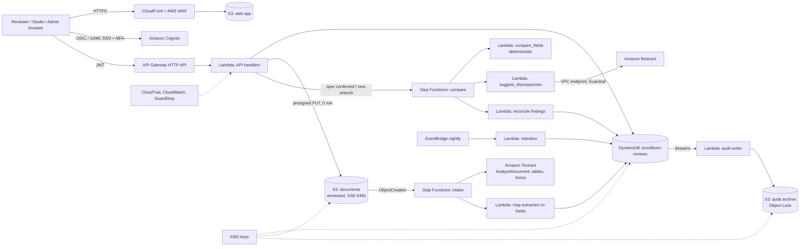

# Proofloom: proposed AWS architecture

Status: this is a design for production, not a running system. The website and the prototype at `/app` are static front ends with no backend. The code in `backend/` is a starting point that has only been tested locally: the Lambda logic has unit tests, and the table definition is a valid `create-table` input that has not been deployed. Nothing is connected to AWS.

## 1. Overview

| Concern | Service / decision |
|---|---|
| Web app | Static build on S3 behind CloudFront (OAC, TLS 1.2+, security headers, WAF managed rules and rate limiting). The marketing site can stay on Vercel or Cloudflare; hosting choice is separate from the SaaS backend. |
| Identity | Cognito user pools, optionally federated to the customer's IdP (SAML/OIDC). MFA required. Groups map to roles: `reviewer`, `studio`, `admin`. |
| API | API Gateway HTTP API with a JWT authoriser. Every handler re-checks the role and the tenant from the token. The client is never trusted for either. The prototype's permission matrix (`src/app/actions.mjs`) mirrors these rules. |
| Documents | Versioned S3 bucket per environment, prefix per tenant. Uploads use presigned PUT URLs (5 minutes, content-type and size limits). Block Public Access, SSE-KMS, access logs. A new artwork version is always a new object and is never overwritten. |
| Extraction | Textract `AnalyzeDocument` (TABLES, FORMS) on specifications and artwork PDFs/images, orchestrated by Step Functions. Mapped values are stored as *extracted*. A reviewer must confirm the specification before any comparison runs. |
| Exact checks | `backend/lambdas/compare_fields`: quantities with unit conversion, codes, GS1 check digits, required wording, list items such as allergens. It shares its fixtures with the prototype engine. |
| AI suggestions | `backend/lambdas/suggest_discrepancies`: Bedrock Converse API through a VPC interface endpoint, with a Bedrock Guardrail. The model ID is configuration. Output is evidence-validated (section 2). |
| Workflow state | DynamoDB single table (section 3). Streams feed the audit writer. TTL attributes implement retention. |
| Scheduling | EventBridge triggers the nightly retention job; S3 lifecycle rules expire files and exports. |
| Observability | Structured CloudWatch logs carrying IDs and event types only, never document text. CloudTrail organisation trail, GuardDuty, AWS Config rules, alarms on DLQ depth and Bedrock errors. |

## 2. AI design

1. **Narrow scope.** AI handles judgements that rules do badly, such as a reworded claim. Exact fields never depend on AI, and switching AI off must never hide an exact mismatch.
2. **Input minimisation.** Prompts contain only claim and statement text. `check_input` rejects tenant, customer, user, file and product identifiers.
3. **Evidence-bound output.** Each suggestion must quote text that appears verbatim in the inputs. `validate` drops anything else, and malformed output fails closed with zero suggestions.
4. **Human gate.** Suggestions are stored as `Suggested · needs decision`. A print decision is blocked until a reviewer confirms or dismisses each one, and a dismissal needs a written reason. AI never changes a finding's status or approves artwork.
5. **Provenance.** `model_id`, `prompt_version`, the rejection count and the deciding reviewer are stored with each suggestion.
6. **Controls.** Per-tenant on/off switch and daily cap (both in the prototype's Policy page). An evaluation set of reviewed examples is re-run on every prompt or model change, and the confirmation rate is tracked as a quality signal (the prototype's admin overview shows it).
7. **No training on customer content.** Use Bedrock under terms that exclude customer content from model training, and record this in the data-processing agreement.

## 3. Data model (DynamoDB single table `proofloom-reviews`)

| Item | PK | SK | Notable attributes |
|---|---|---|---|
| Review | `T#<tenant>#R#<review>` | `META` | product, pack, market, owner, status, latestVersion, comparedVersion, `GSI1PK=T#<tenant>#STATUS#<status>`, `GSI1SK=<updatedAt>` |
| Specification version | same | `SPEC#<v>` | fields[], approvedClaims[], confirmedBy, confirmedAt, s3Key, extraction (Textract job id) |
| Artwork version | same | `ART#<v>` | s3Key, sha256, fields{}, claims[], uploadedBy, uploadedAt, note |
| Finding | same | `F#<id>` | issueId, key, type, severity, source (`check`/`ai`), status, expected, actual, raisedIn, verifiedIn, reason, assignee, `GSI2PK=T#<tenant>#U#<assignee>`, `GSI2SK=<status>#<review>` |
| Comment | same | `F#<id>#C#<ts>` | by, text |
| Decision | same | `DECISION` | version, by, at, second, secondAt, final |
| Policy | `T#<tenant>` | `POLICY` | aiSuggestions, dailyAiCap, twoPersonApproval, requireCriticalSignoff, retention windows |
| AI usage | `T#<tenant>` | `AIUSE#<yyyy-mm-dd>` | count (atomic increment, checked against dailyAiCap) |

Access patterns: list reviews by status (GSI1), list "my findings" (GSI2), and load a whole review in one `Query` on PK. Approval uses a `TransactWriteItems` that re-reads the findings' statuses with a condition expression, so a decision cannot be recorded against stale state. The second approver must differ from the first, and that is enforced in the same condition.

The audit trail is written from DynamoDB Streams to an S3 bucket with Object Lock in compliance mode. That makes it append-only and outside the reach of application roles.

## 4. Security

- **Encryption:** customer-managed KMS keys for DynamoDB, S3, SQS/Step Functions payloads and CloudWatch Logs. TLS 1.2+ everywhere.
- **Network:** Lambdas that call Bedrock or Textract use VPC endpoints. Default-deny egress.
- **Access:** least-privilege IAM per function, with no wildcard resources. Tenant isolation through key prefixes plus IAM `dynamodb:LeadingKeys` conditions on the tenant prefix. A break-glass role requires approval and raises alerts.
- **Application:** server-side authorisation on every call, input validation, upload content-type and size checks, malware scanning of uploads before extraction, CSP and HSTS, dependency scanning, no secrets in the repository.
- **Threats considered:** cross-tenant reads (key conditions and tests), prompt injection through artwork text (no tools, no identifiers, evidence validation, Guardrails), forged approvals (server-side checks plus conditional transaction), data exfiltration through exports (presigned, short-lived, audited).

## 5. Retention (defaults, editable within bounds in the prototype's Policy page)

| Data | Default | Mechanism |
|---|---|---|
| Artwork and specification files, extractions | 24 months | S3 lifecycle; DynamoDB TTL on version items |
| Closed reviews | 180 days after approval | Nightly job archives the review summary, then TTL |
| Exported reports | 36 months | S3 lifecycle |
| Audit log | 60 months | Object Lock retention |
| Backups | 35 days | DynamoDB point-in-time recovery |

## 6. Environments and delivery

Separate AWS accounts for dev, staging and prod (AWS Organizations). Infrastructure as code (CDK or Terraform, not yet written). CI runs `npm test` and `python3 backend/tests/test_lambdas.py`, including the shared rule fixtures, plus IAM/tenant negative tests and dependency scans. Fictional data only outside production.

## 7. Prototype vs production

| Area | Prototype (`/app`) | Production |
|---|---|---|
| Storage | Browser `localStorage` | DynamoDB + S3 |
| Extraction | Values typed into a form | Textract with reviewer confirmation |
| Exact checks | `src/app/engine.mjs` | `compare_fields` Lambda (same rules, same fixtures) |
| AI | Deterministic claim rule | Bedrock + Guardrail + evidence validation |
| Auth | “Demo as” switch | Cognito + SSO + MFA, server-side authorisation |
| Audit | In-memory list | Streams → S3 Object Lock |
| Retention | Preview only | EventBridge job, TTL, S3 lifecycle |

## 8. Not legal advice

Labelling rules differ by product category and market. Proofloom checks artwork against the specification the customer approved; it does not decide whether that specification is compliant. Customer contracts need a data-processing agreement, a sub-processor list (AWS; HubSpot for prospect data only) and data-region choices. Have counsel review before production use.
